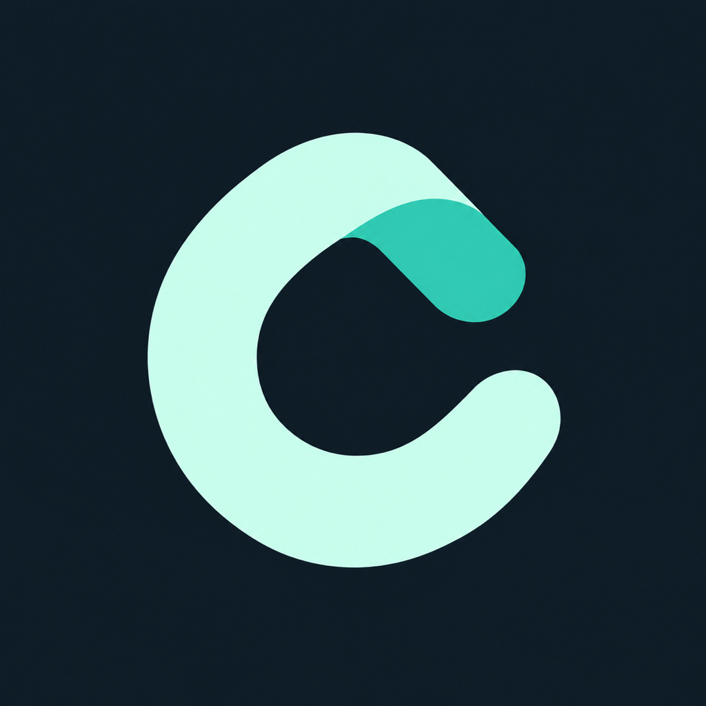

# Cloudified

**Your originals. Two destinations.**

Back up iPhone photos and videos to **Google Photos, Telegram, or both**.
Open source, original quality, and a separate upload queue for each destination.
By [Voryn Labs](https://voryn-labs.github.io/). **iOS 26+ · Version 0.5**

[Download IPA](https://github.com/Voryn-Labs/Cloudified/releases/latest/download/Cloudified-unsigned.ipa) · [Website](https://voryn-labs.github.io/cloudified.html) · [Setup](docs/public/SETUP.md) · [FAQ](docs/public/FAQ.md)

[](docs/public/ANALYTICS.md)
[](docs/public/ANALYTICS.md)

## Built for backup

- **Keep your originals.** Photos and videos upload without local recompression, including HEIC, JPEG and MOV. Live Photos have explicit fallback choices; Telegram preserves both original components.
- **Use either destination—or both at once.** Independent switches, queues, recovery and progress. Separate photo/video counts show what is saved and what remains.
- **Check before uploading.** Recognized remote files are skipped. Uncertain sends are reconciled before another upload.
- **Keep moving past file errors.** Retryable failures go behind ready work, with three total automatic attempts. Problem items show identifying details, a reason and manual Retry.
- **Know when to act.** Sign-in, access and rate-limit problems show guidance for the affected account.
- **Back up your way.** Automatic start on open, iOS background processing, a dim Keep Awake screen, and light/night themes.
- **Archive large videos.** Oversized Telegram files use byte-exact parts with a reconstruction manifest.

### Experimental 0.7 preview

The [0.7 prerelease](https://github.com/Voryn-Labs/Cloudified/releases/tag/build-40828576876) improves
Google receipt recovery, isolated failures and diagnostic reports. It includes
bounded metadata checks for possible existing originals; candidates need review
and are never counted as saved without confirmation. Stable installer updates stay on
**0.5**. [How preview matching works](docs/public/FAQ.md#what-changes-in-the-06-preview).

### New in 0.5

Better Telegram recovery, isolated Google transfer errors, fairer retries and safer
completion handling. Photo scanning and diagnostic cleanup also receive resource
handling improvements. [Full changelog](docs/public/CHANGELOG.md).

## Install

Sign the **unsigned IPA** with Feather, SideStore, AltStore or your preferred
compatible signer. Bring your own signing setup. LiveContainer uses foreground
backup; keep the guest open.

Add the **Voryn Labs** source to browse Cloudified and Musyn:

```text
https://voryn-labs.github.io/source.json
```

Allow Photos access, link your accounts and map a private Telegram channel.
Keep the same signing identity and app container for updates.
[Installation and account guides](docs/public/SETUP.md).

## Before you back up

- **Google is unofficial.** The PhotosBackup-derived integration can change or trigger account restrictions. Unlimited quota and isolation from other Google accounts are not guaranteed.
- **Duplicate checks have limits.** They identify matching content, not every visually similar photo. Compressed or edited copies can differ. The initial remaining count includes files still awaiting a check.
- **Telegram channels are cloud storage, not E2EE.** They are not Secret Chats. Large split videos require reconstruction; Cloudified is an uploader, not a gallery or restore app.
- **iOS controls background time.** Keep Awake can help long foreground runs. A failed transfer may restart from the beginning.

[Privacy and account risks](docs/public/PRIVACY.md) · [Common questions](docs/public/FAQ.md)

## Get help or contribute

Open **Activity → Report a problem** to create a diagnostic link and GitHub issue
draft. Include your version, installer and what happened. Reports are public:
review them and keep credentials and private media out.

[Report an issue](https://github.com/Voryn-Labs/Cloudified/issues) · [Build from source](docs/public/BUILDING.md) · [Contribute](CONTRIBUTING.md) · [Upstream updates](docs/public/UPSTREAM.md)

## License and credits

Cloudified's original code is [MIT licensed](LICENSE). Build, copy, modify and
redistribute it while preserving copyright and license notices. Dependencies
retain their [own licenses](THIRD_PARTY_NOTICES.md).

Created and maintained by [@tinyredphoenix](https://github.com/tinyredphoenix)
under **Voryn Labs**, with AI-assisted architecture, development and review by
**OpenAI Codex**.

Google integration: [g8row/PhotosBackup](https://github.com/g8row/PhotosBackup),
with its [MIT notice](licenses/LICENSE-PhotosBackup.txt) preserved.
Read-only Google metadata adaptation: [xob0t/gpmc](https://github.com/xob0t/gpmc).
Telegram transport: [TDLib](https://github.com/tdlib/td).
Implementation inspiration: [xob0t/gotohp](https://github.com/xob0t/gotohp),
a reference rather than a linked dependency. [Pinned sources and notices](THIRD_PARTY_NOTICES.md).

Not affiliated with Apple, Google, Telegram or the installer projects.
